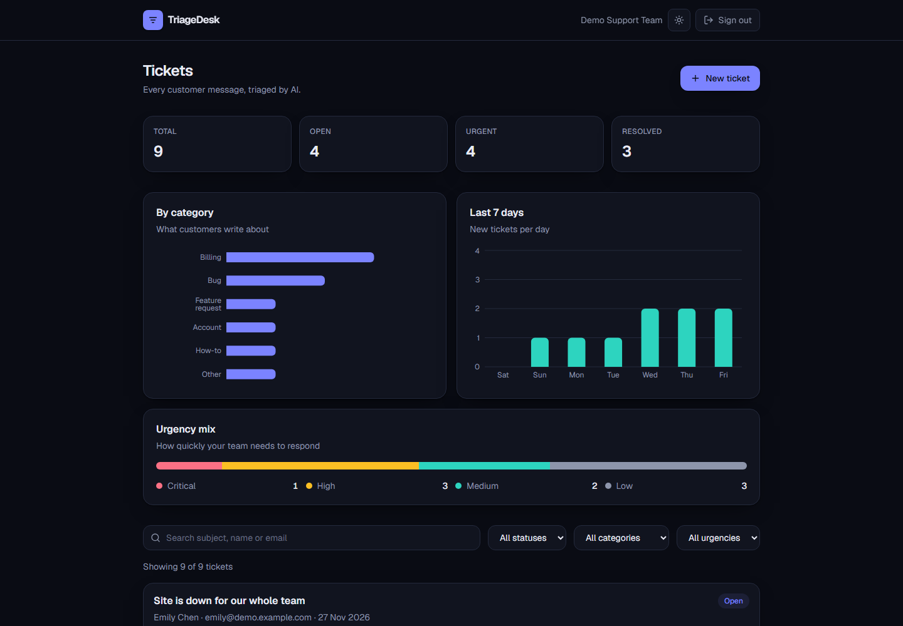
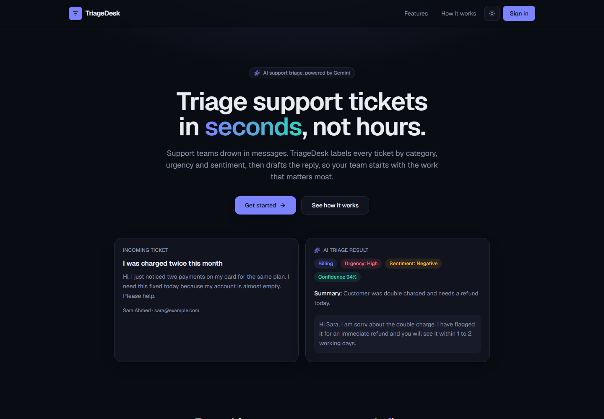
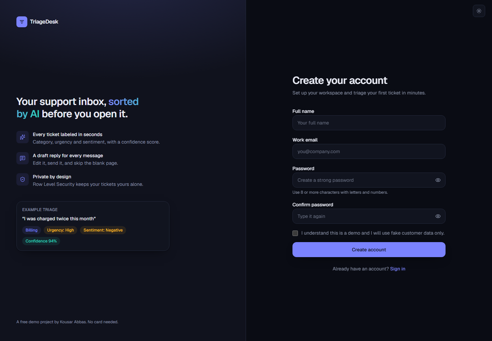
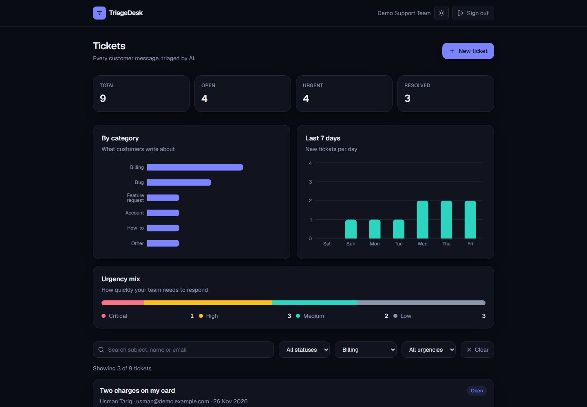
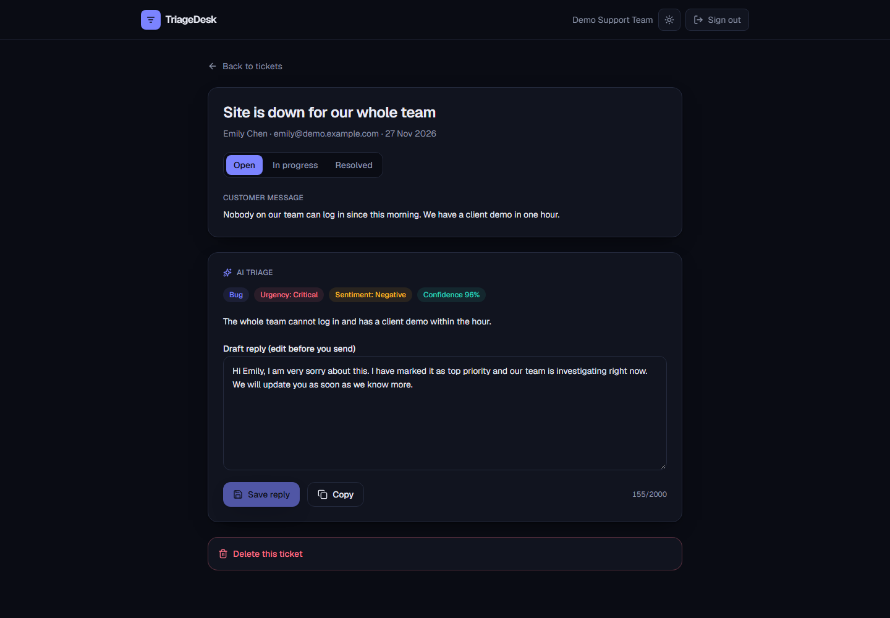
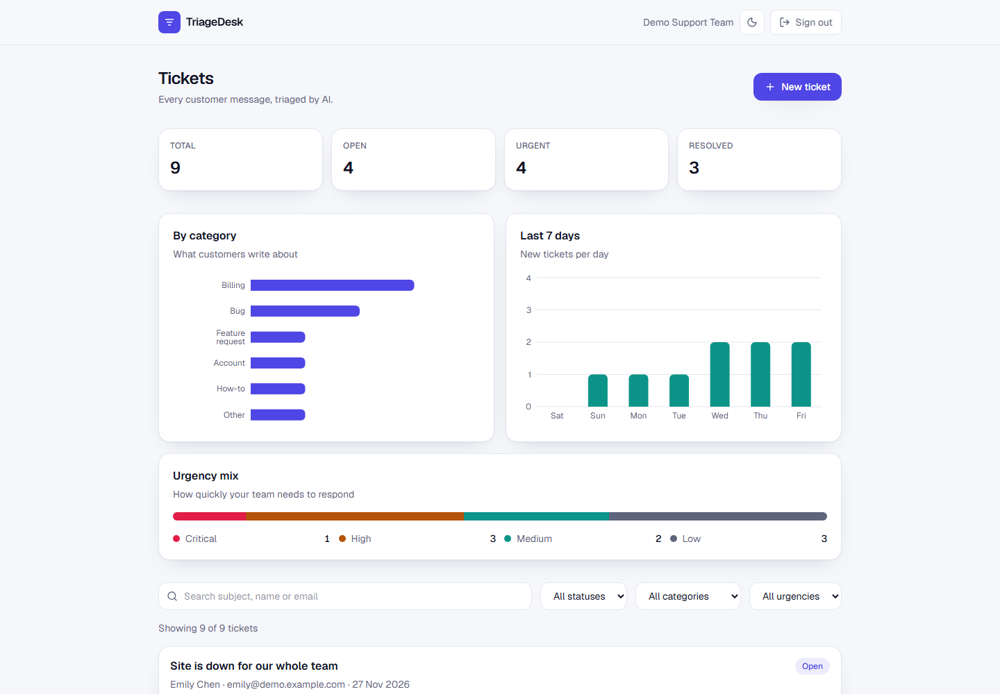
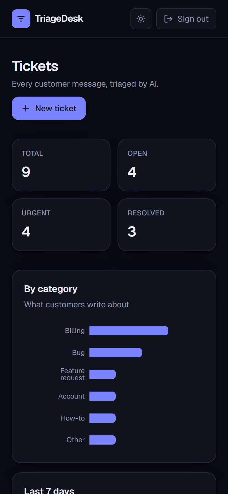
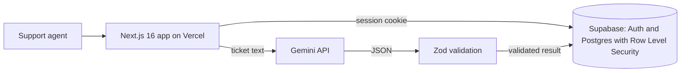

# TriageDesk

> AI-assisted support ticket triage. Every customer message gets a category, an urgency level, a sentiment, a one-line summary and a draft reply in seconds, so a support team starts with the work that matters most.

**[Live demo](https://triagedesk-roan.vercel.app)** | **[Built by Kousar Abbas](https://www.linkedin.com/in/kousarabbas/)** | Project 1 of my 7-project portfolio series



> **Demo notice:** this is a portfolio project. Please use fake customer data only. The AI runs on a free tier, which may use prompts to improve the provider's products and has daily limits.

## The problem

Support teams lose a large part of every day on work that is not support: opening each message, deciding what it is about, judging how urgent it is, and writing a first reply from a blank page. Urgent tickets (a double charge, a full outage) wait in the same queue as simple questions, and the people who are most upset wait the longest.

## What TriageDesk does

1. You add a customer message.
2. An AI model reads it and returns a **category**, **urgency**, **sentiment**, a **one-line summary**, a **draft reply** and a **confidence score**.
3. You edit the reply, copy it, move the ticket through **Open, In progress, Resolved**, and watch the dashboard update.

## Who it is for

- **Small support teams** (1 to 10 people) at software or service companies that share one inbox.
- **Founders and freelancers** who answer customer messages themselves and want a clear priority order.
- **Agencies** that handle support for several clients and need consistent labels and tone.

## Why I built it

I am building a series of seven portfolio projects, each one solving a real industry problem with modern tools. Support triage is a good first problem: it is common, repetitive, and a place where AI can help a person without replacing them. The AI only suggests. A human always reviews and sends the reply. I also wanted to practice the parts of a project that tutorials skip: database security, validating AI output, error states, and honest limits.

## Features

- AI triage with category, urgency, sentiment, summary, draft reply and confidence
- Ticket detail page with an editable draft reply, a copy button and a status switch
- Dashboard with stats and charts (by category, last 7 days, urgency mix)
- Live filters (status, category, urgency) and search, stored in the page address so a view can be bookmarked
- Sign up with a password strength meter, sign in with show/hide password
- Light and dark mode without a flash on load
- Responsive layout, labeled form fields and keyboard-friendly controls
- Empty, loading, error and "not found" states
- Each user sees only their own tickets, enforced by the database

## Screenshots

| Landing | Sign up |
| --- | --- |
|  |  |

| Filters and search | Ticket detail |
| --- | --- |
|  |  |

| Light mode | Mobile |
| --- | --- |
|  |  |

## How it works



1. A server action validates the form with Zod and saves the ticket under the signed-in user.
2. The server sends the ticket text to the Gemini API and asks for a single JSON object.
3. The reply is parsed and validated with Zod. Anything that does not match is rejected, never saved.
4. The triage result is stored, and the dashboard reads it back through Row Level Security.
5. If the AI fails or the daily limit is reached, the ticket stays saved and shows a **Run AI triage** button.

## Tech stack

| Area | Choice |
| --- | --- |
| Framework | Next.js 16 (App Router, Cache Components, `proxy.ts`), React 19, TypeScript |
| Styling | Tailwind CSS 4 with a small design-token system (light and dark) |
| Database and auth | Supabase (Postgres, Auth, Row Level Security) |
| AI | Gemini API (`gemini-3.1-flash-lite`, free tier) through plain `fetch` |
| Validation | Zod 4 |
| Charts and icons | Recharts, lucide-react |
| Hosting and CI | Vercel, GitHub Actions (lint and build) |

## Security and privacy decisions

- **Row Level Security** on the `tickets` table. Every policy compares the row owner to `auth.uid()`, so one user can never read or change another user's tickets.
- **Least privilege.** Only the `authenticated` role has table access, limited to select, insert, update and delete. The `anon` role has none. The app never uses a Supabase secret or service-role key.
- **Server-only secrets.** The AI key is read only on the server and is never sent to the browser. The browser only receives the Supabase publishable key, which is designed to be public.
- **Validation twice.** Forms are validated on the client for speed and again on the server for safety. IDs in URLs are checked as UUIDs.
- **AI output is untrusted.** The model is asked for JSON, and the result is validated against a strict schema before it is saved.
- **Prompt-injection defense.** Customer text is passed as data and the system prompt says to never follow instructions inside it. The model has no tools and cannot take actions, so the worst case is a wrong label that a human reviews.
- **Cost protection.** Each user can run 25 AI triages per day, and a ticket can only be triaged once, so a free quota cannot be drained by repeated clicks.
- **Safe search.** Search input is sanitized before it is used in a database filter.

## Getting started

Requirements: Node.js 22 or newer, a free [Supabase](https://supabase.com) project and a free [Gemini API key](https://aistudio.google.com/apikey).

```bash
git clone https://github.com/scrapyard333/triagedesk.git
cd triagedesk
npm install
cp .env.local.example .env.local
```

1. Fill in `.env.local` with your Supabase URL, your Supabase **publishable** key and your Gemini key. Never commit this file.
2. In the Supabase SQL Editor, run `supabase/migrations/0001_tickets.sql`, then `supabase/migrations/0002_tickets_grants.sql`.
3. In Supabase, open Authentication, then Providers, then Email. Make sure the provider is on. For a demo, turn "Confirm email" off. A real product should keep it on.
4. Start the app:

```bash
npm run dev
```

| Script | What it does |
| --- | --- |
| `npm run dev` | Start the development server |
| `npm run build` | Create a production build |
| `npm run lint` | Run ESLint |
| `npm run screenshots` | Capture the README screenshots (needs Playwright and a demo login) |

## Project structure

```text
src/
  app/
    auth/actions.ts        sign in, sign up and sign out (server actions)
    dashboard/             protected area: tickets, charts, detail, new ticket
    login/  signup/        auth pages
    opengraph-image.tsx    social preview image
  components/              UI building blocks
  lib/
    ai/triage.ts           Gemini call and Zod validation
    supabase/              server client and session refresh
    dashboard.ts           filters, stats and chart data
  proxy.ts                 route protection
supabase/migrations/       SQL for the table, policies and grants
scripts/screenshots.mjs    captures the README screenshots
```

## Decisions and trade-offs

- **Free AI tier over a paid model.** The project has to be reproducible by anyone at no cost. The trade-off is low rate limits and data-use terms, which is why the demo asks for fake data and enforces a daily cap.
- **Plain `fetch` instead of an AI SDK.** One small function, no extra dependency, and it is easy to swap the provider.
- **Strict schema around the model.** An LLM can return almost-right output. Validating it means a bad answer becomes a retry button, not a corrupted row.
- **Grants are explicit.** New Supabase tables do not give signed-in users access automatically. Row Level Security decides which rows a user can touch, and grants decide whether they can touch the table at all. This project needs both, and the second one is easy to forget.
- **Cache Components.** The shell of each page is prerendered and the user-specific parts stream in behind loading states.

## Known limitations

- Each account is its own workspace. There are no teams or roles yet.
- Tickets are entered by hand. There is no email or chat intake.
- AI runs on a free tier, so it can be rate limited at busy times.
- Charts use the latest 1000 tickets.
- There are no automated tests yet. CI runs lint and a production build.
- "Confirm email" is off for demo convenience.

## Roadmap

**Next**
- Automated tests (unit tests for validation and filters, end-to-end tests for the main flow)
- Pagination and CSV import and export
- Per-IP rate limiting and an audit log of who changed what

**Later**
- Teams, roles and shared inboxes
- Ticket intake from email, a web form widget and WhatsApp
- Replies grounded in a company knowledge base (retrieval with `pgvector`) so drafts quote real policies
- Learn from edits: compare the draft with what the agent actually sent and improve the prompt
- Service-level timers, automatic assignment and Slack notifications
- Automatic fallback between AI models when one reaches its limit
- Urdu and other language interfaces

## Customize it or work with me

TriageDesk is built to be adapted. Typical changes take days, not months:

- **Your categories and tone:** a different label set, urgency rules and reply style for your business
- **Your channels:** connect email, a contact form or WhatsApp so tickets arrive on their own
- **Your data:** add customer or order lookups so replies can use real details
- **Your team:** multiple agents, roles and assignment

If you run a support team, or want something like this for your own workflow, message me on [LinkedIn](https://www.linkedin.com/in/kousarabbas/). You are also welcome to open an issue or fork the project.

## What I learned

- Signed-in users still need explicit table grants, even with correct Row Level Security.
- Next.js 16 Cache Components make you decide what is static and what depends on the request, and that makes pages faster and clearer.
- Reliable AI features need validation, limits and a human in the loop, not just a good prompt.

## License

[MIT](LICENSE) © 2026 Kousar Abbas
